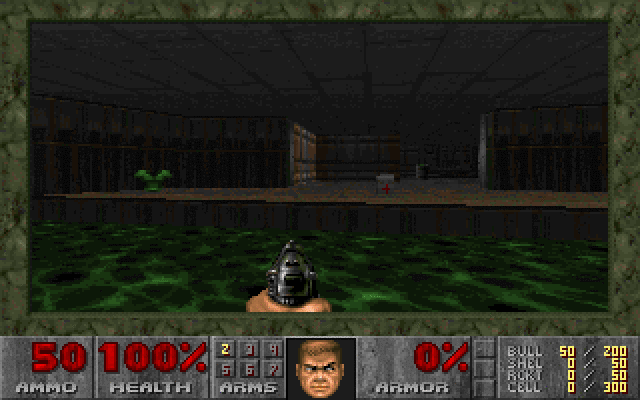

# Linux DOOM in Podman

Build and play id Software's original Linux DOOM with rootless Podman.
The engine runs in a 32-bit container, Xephyr provides its 8-bit X11 display,
and effects and music play through your desktop audio service.

Run on **Windows 11**, using Ubuntu 20.04 inside **WSL2** with **WSLg**.
Run the commands below in your Ubuntu/WSL terminal.



## Quick start

```sh
cd ~
git clone https://github.com/ahnaj/podman-doom-sanity-check.git
cd podman-doom-sanity-check
bash setup.sh
bash run.sh
```

Keep the checkout in WSL's Linux filesystem (for example, under `~`),
not `/mnt/c`: the original 32-bit engine can fail to read files there.

Run as your normal desktop user. Setup installs missing dependencies on
Ubuntu/Debian using `sudo`, fetches the pinned source from
[id Software](https://github.com/id-Software/DOOM), builds both images, and
downloads the checksum-verified DOOM 1.9 shareware IWAD if `wad/` is empty.
The first setup needs internet access; subsequent gameplay runs locally.
The base image is selected explicitly from Docker Hub (`docker.io`), and
built images use `localhost/` with pulls disabled when run. No Docker Hub/Quay
registry selection is needed. Installing missing host packages may still
require your `sudo` password.
Ubuntu 20.04 requires the libcontainers package repository, which setup adds
with a repository-specific signing key.

Requirements: x86 Linux with 32-bit execution support, an X11 desktop or
WSLg, and a running PulseAudio or PipeWire PulseAudio service. Other Linux
distributions can use the scripts after installing the host tools listed
by `setup.sh`. Headless sessions need a graphical desktop first.

## Play

```sh
bash run.sh -warp 1 1       # start E1M1
bash run.sh -skill 4        # Ultra-Violence
```

Arrow keys move, Ctrl fires, Space opens doors, and Esc opens the menu.
Ctrl+Shift toggles Xephyr's keyboard/mouse grab. Quit through DOOM's menu;
the launcher closes its display afterward. Saves and configuration live
in `.run/`.

For the full game, place your own legally obtained `doom.wad`, `doomu.wad`,
or `doom2.wad` in `wad/` before setup. Use one IWAD at a time.

Sound effects and music are enabled by default. Setup packages WildMIDI and
FreePats instruments inside the container; no MIDI device, soundfont download,
or Windows audio-server installation is needed. The original soundtrack plays
with sampled instruments, with volume controlled from DOOM's Options menu.
After updating an older checkout, rerun `bash setup.sh` to rebuild audio support.

## Check

```sh
bash test.sh
```

With the shareware `wad/doom1.wad`, this plays a demo twice and separately
checks effects and music for nonzero samples on the host audio monitor.
Keep other audio quiet during the check. Your saved volume settings are unchanged.
It also checks music looping, pause/resume, mute, stop, and replay without
altering the song data, using a synthetic test song and no audio device.
It adapts the demo's version byte in a temporary copy; the IWAD is unchanged.
Build, display, and audio were tested with rootless Podman 3.4.2 on
Ubuntu 20.04 under WSL2 on Windows 11.

The launcher automatically finds WSLg's `/mnt/wslg/PulseServer` or your Linux
desktop's PulseAudio/PipeWire socket, and tries to start an installed desktop
audio service if needed. Explicit `PULSE_SERVER`, `PULSE_COOKIE`, and
`PULSE_SINK` settings are respected; the server must use a local Unix socket.
If audio fails on Windows 11, run `wsl --update` in PowerShell and reopen
Ubuntu. Check that Windows and DOOM's volume controls are unmuted. On Linux,
check `pactl info` and your PulseAudio or `pipewire-pulse` service. If the
display fails, check `xdpyinfo` in the same terminal.

## Repository

Only scripts, container definitions, and compatibility changes belong in
Git. `source/`, `out/`, `wad/`, and `.run/` are ignored; they contain downloaded
source, binaries, game data, saves, and temporary credentials.

The source revision, base image, and Debian package snapshot are pinned.
Compilation runs offline against a temporary source copy. The patches fix
modern compiler compatibility, X11 palette installation, and sound-server
startup/loading; `audio.c` replaces its obsolete OSS output, and `music.c`
implements the missing music functions using WildMIDI and SDL2 audio.

The game container shares host networking and IPC for local X11/MIT-SHM,
and mounts the host audio socket. Xephyr disables TCP listening and uses
an authorization cookie. SELinux container labeling is disabled for this
local desktop session. Game data and executables are mounted read-only.

No upstream source or WAD is distributed in this repository. Upstream code
and game data remain subject to their respective licenses; see the fetched
`source/LICENSE.TXT` and the shareware distribution's terms.
